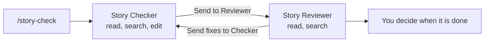

# Lab 5: Prompt files and handoffs

Previous: [Lab 4](../lab-4-instruction-file/README.md) | [Overview](../../README.md) | Next: [Lab 6](../lab-6-prove-what-each-file-did/README.md)

**Time:** 15 minutes. **Finished files:** [solution/.github](solution/.github/)

| Step | Answer |
|---|---|
| The files | A prompt file is a saved work order. A handoff is a button that passes work from one agent to another. |
| Where they live | `.github/prompts/story-check.prompt.md`, and `handoffs:` inside agent files |
| When they load | The prompt file runs when you type `/story-check`. Handoff buttons appear under an agent's answer once it finishes. |

> **Before you start:** handoff buttons only work in the **Local** harness.
> Start every chat in this lab with **Session Target** set to **Local**. In
> another harness the buttons never appear, even when every file is correct.

The idea is a maker and a checker. The Checker writes. The Reviewer reads, and
has no tool to write with.



## Build it

**Part A: the Reviewer.** Copy
[solution/.github/agents/story-reviewer.agent.md](solution/.github/agents/story-reviewer.agent.md)
into `.github/agents/`. Read it before you move on. Notice three things:

- `tools: [read, search]`. The Reviewer physically cannot change the note.
- A fixed output format: Verdict, Gaps, Questions. Reviews become comparable.
- "On a second review, check only the gaps you listed before." Without this, the
  loop can produce new small complaints forever.

**Part B: give the Checker a handoff.** Add this to the front matter of
`story-checker.agent.md`, after `argument-hint`:

```yaml
handoffs:
  - label: Send to Reviewer
    agent: story-reviewer
    prompt: Review the story check note I just saved against the story, including its Notes section.
    send: false
```

And add this section above `## Rules`:

```markdown
## When the Reviewer sends work back

- Fix only the items the Reviewer listed.
- Keep the existing question IDs. New questions get the next number.
```

**Part C: the prompt file.** Create `.github/prompts/story-check.prompt.md`:

```markdown
---
description: "Start the story check workflow: check one Riverside Library story, save the note, then hand off to the reviewer."
agent: story-checker
argument-hint: "Story ID, for example US-203"
---

Check story **${input:storyId:US-203}**.

1. Find the story in `practice-app/stories/`.
2. Use the `room-story-check` skill.
3. Save the note to `story-checks/`.
4. When you are done, remind me to click **Send to Reviewer**.
```

| Part | What it does |
|---|---|
| `agent: story-checker` | Runs the prompt with that agent |
| `${input:storyId:US-203}` | Asks you for a value, with `US-203` as the default |
| `send: false` on a handoff | Fills in the next prompt but waits for you to press Enter |

## Prove it loaded

1. Start a new chat with **Session Target** set to **Local**. Type `/story-check`
   and enter `US-203`. If it does not ask you for a value, type
   `/story-check US-203` instead.
2. The Checker saves `story-checks/US-203-check.md`. Click **Keep**.
3. Wait for the Checker's answer to finish. A **Send to Reviewer** button appears
   under it. Click it, then press Enter to send the prompt it fills in. Read the
   verdict. Did it catch the rules in the Notes section?
4. Click **Send fixes to Checker** under the Reviewer's answer, and press Enter.
   The Checker updates the note.
5. Click **Send to Reviewer** again. The verdict should now be **Ready**.

**If no button appears,** check these in order:

1. The chat's **Session Target** is **Local**.
2. The answer has finished. Buttons appear only after it does.
3. You started a new chat after your last change to an agent file.
4. If you started with `/story-check`, try the other way in: choose
   **story-checker** from the agent picker and type `US-203`. The buttons belong
   to the agent that answered.
5. The `handoffs:` block is indented exactly as shown, and `agent:` matches the
   target file name without `.agent.md`.

## Break it on purpose

1. In the Checker's handoff, change `send: false` to `send: true`.
2. Run the workflow again. The handoff now sends by itself when you click the
   button, and you lose the moment where you read the prompt before it goes.
3. Change it back.

Then try a typo: change `agent: story-reviewer` to `agent: story-review`, start a
new chat, and run the workflow. The handoff cannot find its agent: depending on
your VS Code version, the button is missing or the switch fails. Fix it.

## What it cannot do

A handoff is a human checkpoint, not a gate. Nothing stops you from clicking
through without reading. And the Reviewer is AI too, so it can share the
Checker's blind spots.

## Next

[Lab 6](../lab-6-prove-what-each-file-did/README.md) asks you to prove which
file caused each behavior you saw.
