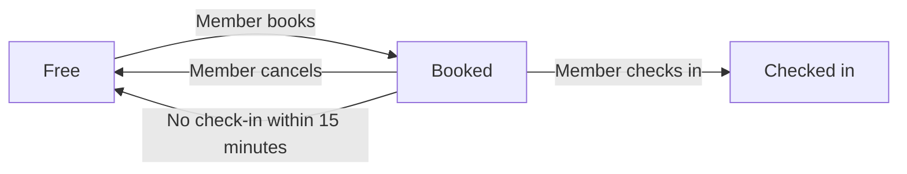

# Riverside Library Room Booking (fictional)

Riverside Library Room Booking is a pretend website. Nothing in it is real, so
you can experiment freely. Every name, room, and rule below is invented for this
lab.

## The story in one breath

A **Member** of the library wants a quiet place to study. They **Book** a
**Room** for a time slot. When they arrive, they **Check in**. If they do not
check in, the room is **Released** so someone else can use it.

## Five words you need

| Word | Meaning |
|---|---|
| Room | A study room members can book, such as R-12 |
| Member | A person with a library card |
| Booking | A member reserving a room for one time slot |
| Check-in | The member confirming they have arrived |
| Release | The room goes back to Free |

## Room lifecycle

## Pages

- **Find a Room**: rooms that are Free for the chosen time.
- **My Bookings**: rooms this member has booked.
- **Booking Details**: room, date, start time, end time, and action buttons.

## Test data

| Member | Details |
|---|---|
| Sam Lee | Adult, membership active |
| Ava Cruz | Age 14, membership active, guardian listed |
| Jo Park | Adult, membership suspended |

| Room | Details |
|---|---|
| R-12 | Seats 4 |
| R-14 | Seats 4, accessible room |
